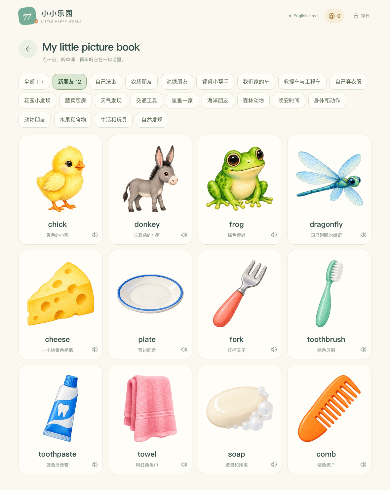

# 77 的小小乐园

一位爸爸用 AI 协助开发的中英双语互动乐园。起点很具体：把孩子生活中熟悉的动物、食物、交通工具做成能点、能听、能玩的内容，让学习任务、小游戏和收藏小屋连在一起。

**[在线试玩](https://77-qiqi-playground.netlify.app/) · [运行与使用说明](docs/PROJECT_GUIDE.md) · [素材与声音说明](docs/ASSETS.md)**

这是持续迭代的家庭项目。主要面向 iPad 触控使用，由家长陪同体验；互动记录不代表长期掌握，也没有经过教学效果验证。



## 当前能做什么

| 内容 | 当前实现 |
| --- | --- |
| 双语图画书 | 中文 117 项、英文 117 项，共 234 个内容项；可听名称、提示与生活短句 |
| 本地声音 | 895 段 MP3，英文 389 段、中文 506 段；运行时无需在线语音接口 |
| 互动任务 | 听音选图、词图配对、听短句找图；中文选字由家长设置 |
| 小游戏 | 抓娃娃、推币、泡泡找朋友、小屋捉迷藏、红怪兽厨房、熊猫猪赛跑 |
| 收藏小屋 | 109 种收藏、22 个场景；玩具可拖动摆放，位置会保存 |
| 进度与备份 | IndexedDB 本机保存；可导出、恢复，部分游戏支持刷新续玩 |
| 离线与更新 | Service Worker 校验素材、显示下载进度、按文件续传；更新前保存进度 |

完成一轮任务可以得到游戏币，游戏内获得伙伴后放进收藏小屋。币仅用于项目内互动，不涉及充值、支付或真钱奖励。时长与内容由家长设置。

## 版本状态

截至 2026 年 11 月 2 日，本仓库整理的是 **V30 加 10 月 31 日离线下载修复**。在线试玩仍是 **10 月 30 日发布的 V30**，尚未包含这次下载修复；线上可能出现完整离线包下载失败。在线地址与仓库代码不应视为完全相同的版本。

本地测试 122 项通过。真实 iPad Safari 的触控、扬声器听感、完整缓存与断网重开仍需实机验收。不能把桌面测试写成 iPad 已全面通过。

## 本地运行

使用 Node.js 22.23.1（本次验证版本，见 `.nvmrc`），在项目目录运行：

```sh
npm ci
npm test
npm run build
npm run preview
```

浏览器打开 <http://127.0.0.1:4178/>。开发模式运行 `npm run dev`，地址为 <http://127.0.0.1:4177/>。

家长入口口令为 **7707**，用途是防止孩子误触，**不是账号密码或访问鉴权**。试玩不需要注册。

项目已包含图片和录音，运行与构建不需要下载语音模型或配置 API Key。构建后的离线资源约 80 MB，首次完整下载需要网络。开发模式不用于验证离线缓存。

## 存档说明

存档只存在当前设备、当前浏览器和当前站点地址中，不自动跨设备同步。更换网址、浏览器或清理网站数据前，请先从家长入口导出备份。Safari 与添加到主屏幕后的应用，也不要假设会自动共享存档。

仓库包含代码、静态素材和回归测试样例；不包含孩子的真实使用存档、本地 HTTPS 私钥、部署凭证或本机模型环境。测试目录引用的 `references/` 和 `output/` 文件是历史基准与构造样例，用于验证旧内容和存档兼容性。

## 项目结构

- `src/`：React 与 TypeScript 界面、学习流程、游戏及本地存档。
- `public/`：插画、895 段音频与音频制作清单。
- `scripts/`：内容整理、音频制作、离线构建与本地 HTTPS 辅助脚本。
- `tests/`：学习与奖励逻辑、内容完整性、存档兼容、离线更新等测试。
- `references/`、`output/`：仅提交测试和内容脚本所需的历史样例。
- `docs/`：面向访客的使用说明与素材说明。

## 反馈与复用

反馈时请提供设备、浏览器、界面显示的资源版本、操作步骤与预期结果。不要公开上传真实孩子存档；优先使用新建测试存档重现问题。

项目代码与素材目前未统一指定开源许可证。公开展示不等于授予任意商业复用权；需要分发、改编或商业使用时，应先明确相应授权，素材来源说明见 [ASSETS.md](docs/ASSETS.md)。本项目没有随仓库发布语音模型权重。
